# Dockside

**A bedside / desk mode for Android.** When your phone is charging, lying on its side and locked, Dockside turns it into a glanceable full-screen display with widgets, a photo frame and big clocks. In a dark room everything turns deep red.

Dockside is an independent, open-source bedside mode for Android, inspired by the nightstand modes of modern phones. All of its code, icons and clock designs were made for this project, and it uses only open-licensed fonts.

<p align="center">
  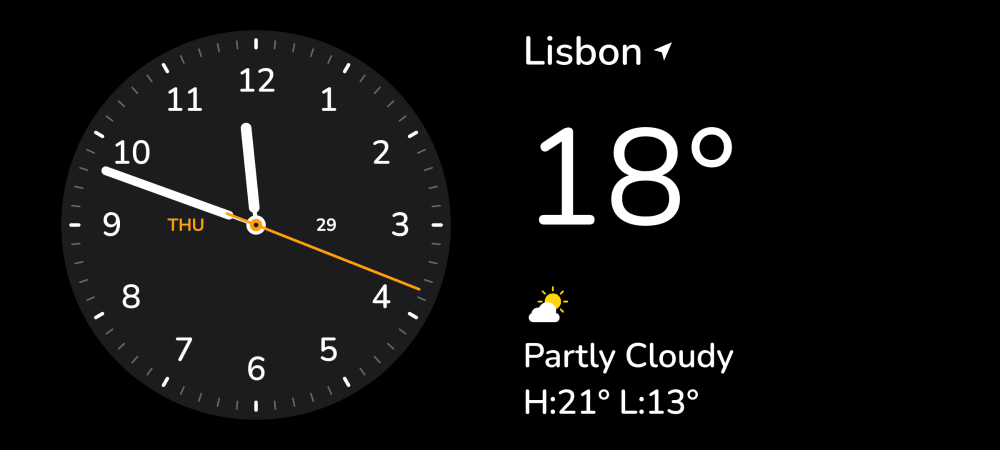
  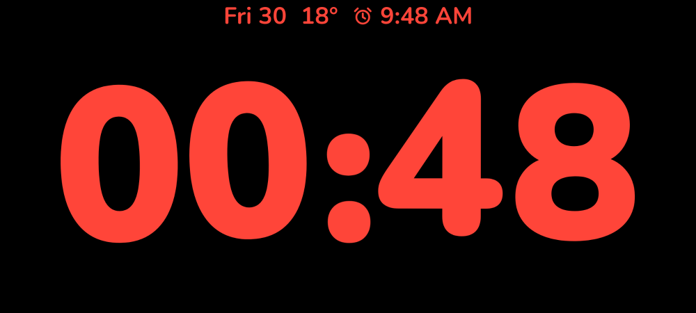
</p>

## Features

| | |
|---|---|
| **Activation** | Starts when the phone is **charging + on its side (landscape) + still + locked**. For phones with a broken motion sensor, *Start in any position* drops the orientation check. It also starts right away when you lock a phone that is already standing sideways on a charger. Unplugging or turning the phone upright leaves Dockside. |
| **Three views** | Swipe **horizontally** between *Widgets*, *Photos* and *Clock*. Swipe **vertically** inside each view to change widget, album or clock face. |
| **Widgets** | Two independent **Smart Stacks**. Built-in widgets: analog clock, square clock, digital clock, world clock, city time, day calendar, month calendar, Up Next, weather, hourly forecast, battery, batteries of connected Bluetooth headphones, speakers and watches (a device appears as soon as it connects; its ring fills once it reports a level), next alarm, photos, Now Playing (with controls) and an interactive stopwatch. |
| **Smart Rotate & Suggestions** | Stacks automatically surface the most relevant widget (an upcoming meeting, the alarm at night, music while playing). *Widget Suggestions* temporarily add Now Playing when music starts. |
| **Edit mode** | **Long-press** a stack. The phone asks to unlock, then the stack jiggles. Use **+** to add from the widget gallery, **−** to remove, and the toggles for Smart Rotate and Widget Suggestions. |
| **Tap to open** | Tap a widget to reveal an ↗ arrow that opens the related app (after unlocking). |
| **Clocks** | Eight faces: **Digital** (rolling digits, date, temperature, alarm), **Analog** (sweeping second hand), **Float** (bubbly, overlapping two-tone digits with pearl-like colon dots and a bouncy change animation), **Solar** (a sun glow that follows the time of day) and **World** (dotted world map with live day/night and its boundary line, your place and time, and your world-clock cities as dots), **Lines** (a full-screen analog dial whose marks run along the screen edges), **Gradient** (wide numerals on a slowly drifting colour wash) and **Tall** (full-height condensed digits; the old digit drifts away as the new one arrives). Every face is alive: on Float, Digital, Tall, Gradient and Solar each digit hovers around its own place on its own rhythm (the analog faces and World stay still); when you swipe to a face it assembles itself (hands sweep round from 12, digits rise in one by one); the colon breathes, a new minute springs up while the old one flies away, rays turn around the Solar sun, a trail of light follows the Lines second hand and soft lights wander over the Gradient wash. Long-press, then tap the colour circle to pick a colour. |
| **Photos** | A slow, cross-fading slideshow with a gentle zoom. The time sits in the top-right corner with a charge ring while charging, and the date the photo was taken is shown at the bottom. It uses your *Featured* photos (chosen with the system photo picker) and your largest device albums. Swipe up or down to switch albums; long-press and use the 👁 button to hide albums. |
| **Night Mode** | The whole screen fades to a deep red so it doesn't dazzle at night. Choose in Settings: **with the light sensor** (default: red only in a dark room, full colour otherwise and when the phone has no working light sensor), **on a schedule** (23:00–6:00) or **off**. The settings screen shows the live light reading. |
| **Display** | *Turn display off*: **Automatically** (in a dark, still room), **After 20 seconds**, or **Never**. **Motion to Wake** uses the accelerometer. |
| **Full-screen notifications** | New notifications appear as large cards. The **Show Preview on Tap Only** setting hides their content until tapped. |
| **Now Playing** | When playback starts, a full-screen player with artwork, progress and controls appears. Drag or tap the progress bar to jump within the track (also in the Now Playing widget). Close the player and the music shrinks into a small dark circle at the top of the screen whose bars move with the music's loudness, in a colour taken from the cover; tap it to bring the player back. |
| **Per-charger memory** | The last view is remembered per charger type (AC, USB, wireless, dock). |
| **Screen saver** | Dockside is also an Android **screen saver (Daydream)**, so the system can start it by itself while charging or docked. |
| **Languages** | English, Russian |
| **Burn-in protection** | On by default: everything on screen shifts by 2–3 pixels every few minutes, too little to notice, so no pixel shows the same thing for hours. |
| **Version** | The version and build number are shown at the bottom of the settings screen. |

## Screenshots

| | |
|---|---|
| 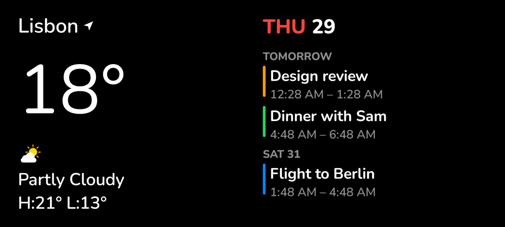 | 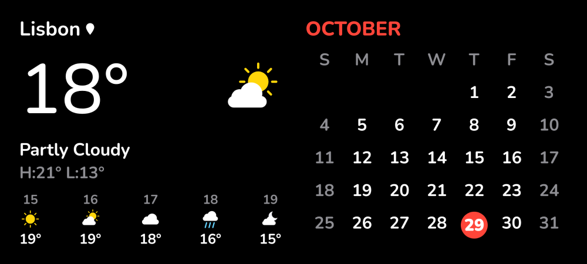 |
| 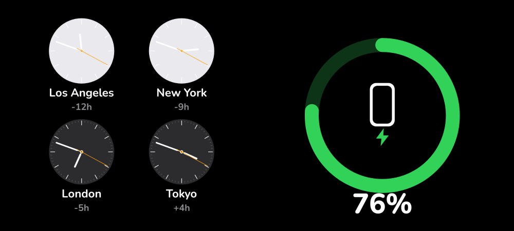 | 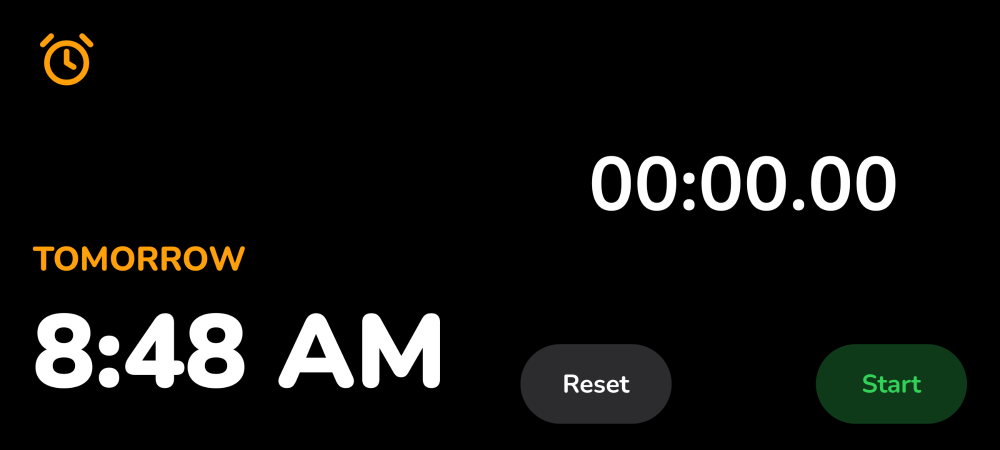 |
| 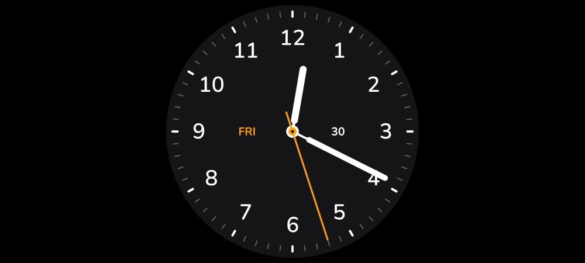 |  |
| 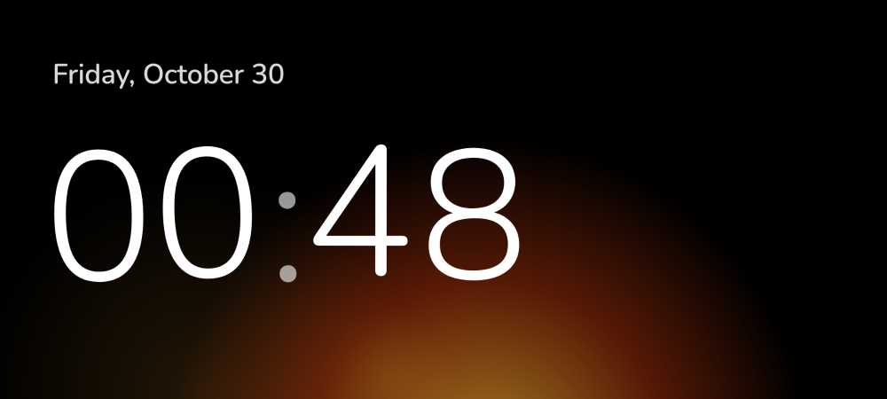 | 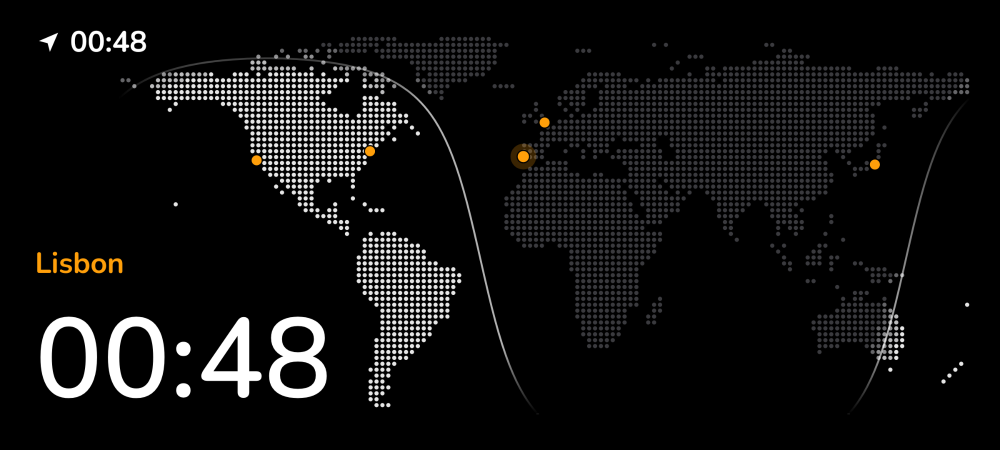 |
| 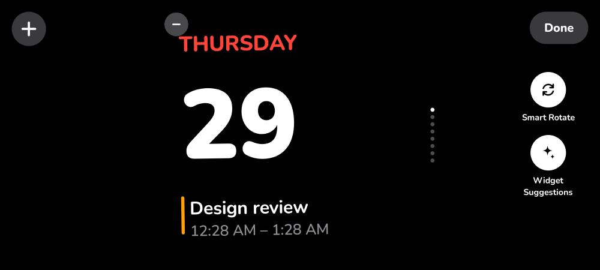 | 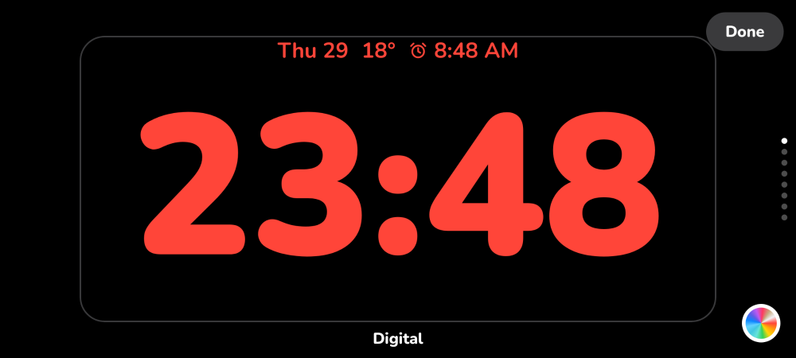 |
| 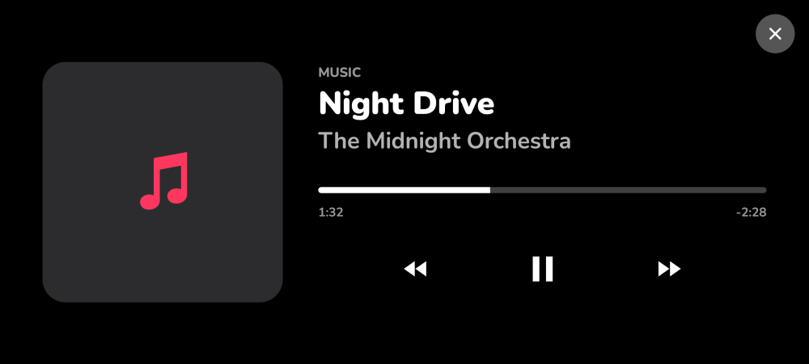 | 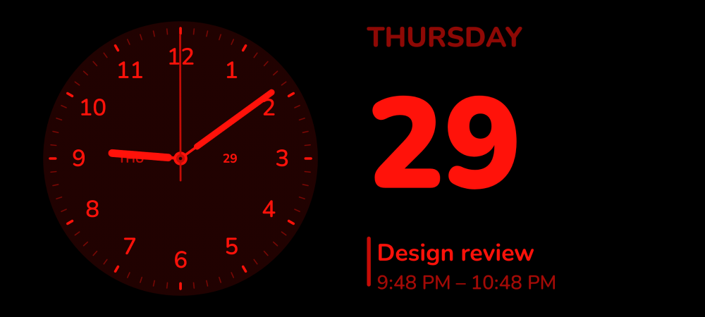 |
| 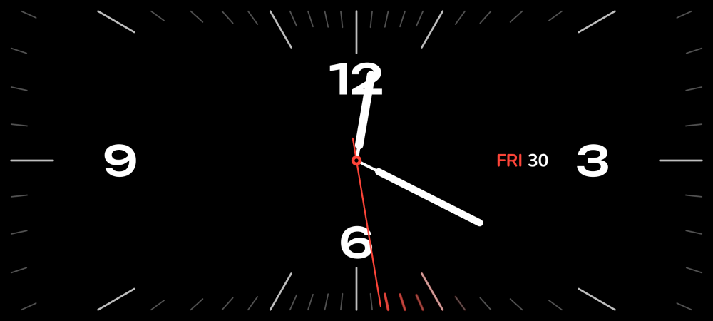 | 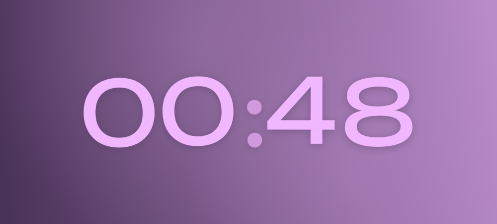 |
| 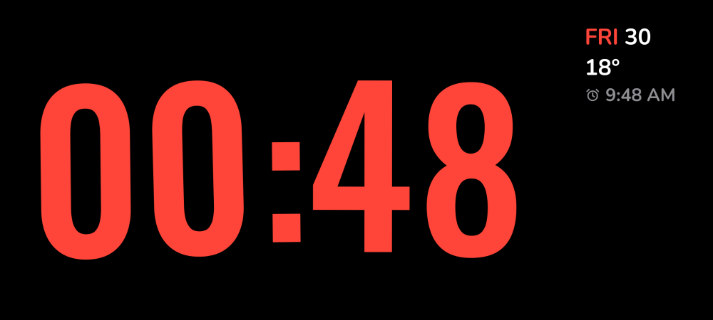 | 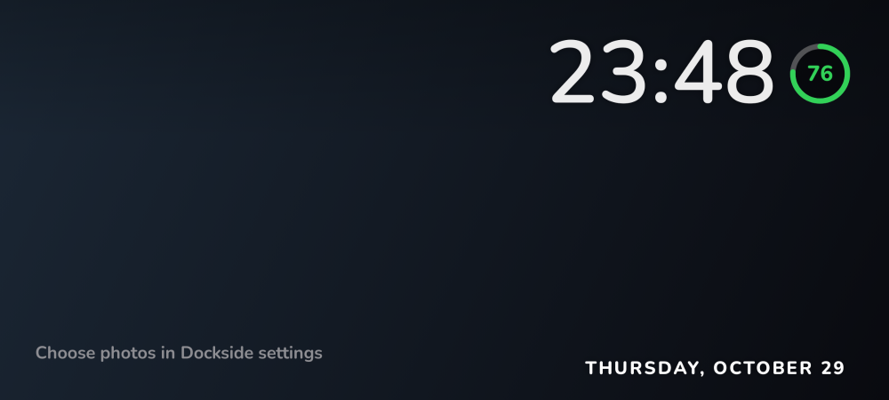 |
| 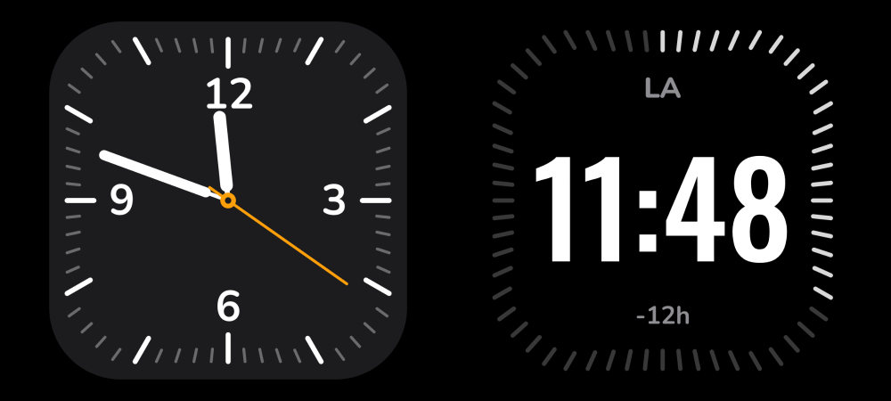 | 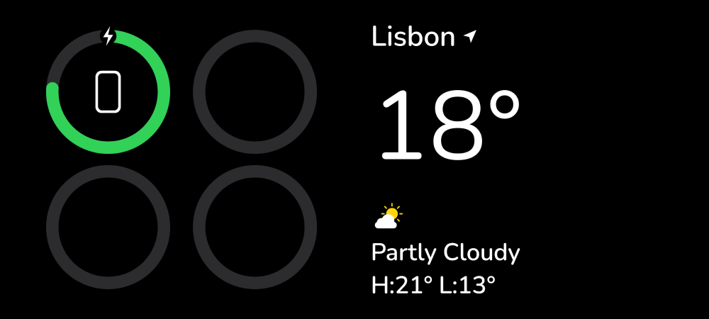 |
| 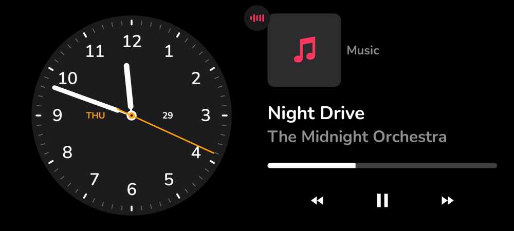 | 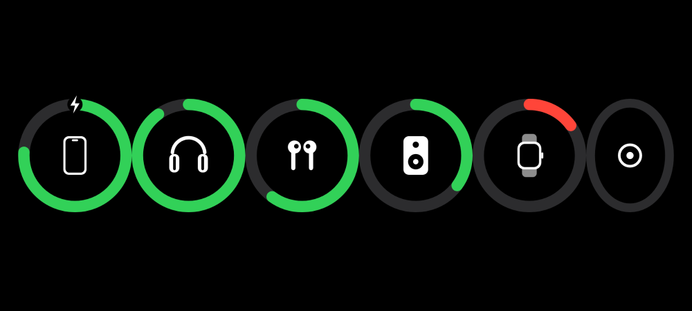 |

The screenshots are rendered by the Paparazzi tests in [`ScreenshotTest.kt`](app/src/test/java/io/github/dockside/ScreenshotTest.kt). The Night Mode image applies the app's own red colour matrix to a screenshot.

## Install

Download `Dockside-x.y.z.apk` from [Releases](../../releases) and open it on the phone (allow installing from your browser or file manager). Requires **Android 8.1+**; Android 12+ is recommended.

### First-run setup

Open **Dockside** and allow the following under *Permissions*:

| Permission | Why |
|---|---|
| Notifications | The small "Dockside is ready" service notification |
| **Full-screen launch** (Android 14+) | Lets Dockside appear over the lock screen. **Required for automatic start.** |
| Display over other apps *(optional)* | Makes the launch more reliable on some phones |
| Battery optimisation | Keeps charging detection alive in the background |
| Notification access *(optional)* | Full-screen notifications and Now Playing |
| Music bars *(optional)* | The bars in the collapsed player follow the music. Android lists this as the microphone, but Dockside only measures the loudness of what is playing and records nothing. |
| Nearby devices *(optional, Android 12+)* | Battery levels of connected headphones and watches |
| Calendar, Location *(optional)* | Calendar and weather widgets (weather comes from [Open-Meteo](https://open-meteo.com), no account needed) |

Then put the phone on a charger, stand it on its side and lock it. Use **Open Dockside now** to preview at any time.

> Some manufacturers (Xiaomi, Huawei, Oppo and others) kill background services aggressively. If Dockside doesn't start, allow *Autostart* for it, or set it as the **screen saver**: *Settings → Display → Screen saver → Dockside → When to start: While charging*.

## Build from source

Requirements: JDK 17 and the Android SDK (platform 35). On macOS with Homebrew:

```sh
brew install openjdk@17
brew install --cask android-commandlinetools
export JAVA_HOME="$(brew --prefix openjdk@17)/libexec/openjdk.jdk/Contents/Home"
export ANDROID_HOME="$(brew --prefix)/share/android-commandlinetools"
yes | sdkmanager --licenses && sdkmanager "platforms;android-35" "build-tools;35.0.0" "platform-tools"

./gradlew assembleDebug          # app/build/outputs/apk/debug/app-debug.apk
./gradlew recordPaparazziDebug   # re-render screenshots on the JVM
```

### Signed release builds

Create `keystore.properties` in the project root. It is git-ignored; never commit it or the keystore.

```properties
storeFile=/absolute/path/to/release.jks
storePassword=…
keyAlias=dockside
keyPassword=…
```

Then run `./gradlew assembleRelease`. In CI the same values come from the secrets `DOCKSIDE_KEYSTORE_BASE64`, `DOCKSIDE_KEYSTORE_PASSWORD`, `DOCKSIDE_KEY_ALIAS` and `DOCKSIDE_KEY_PASSWORD`. Pushing a tag such as `v1.0.0` builds a signed APK and attaches it to a GitHub release (see [`.github/workflows/release.yml`](.github/workflows/release.yml)).

## How it works

```
service/MonitorService     foreground service: power + accelerometer + screen-off → launch
service/NotificationWatcher notification listener: notifications + active media session
standby/StandbyActivity    shows over the lock screen; unlock requests for edit mode
standby/DocksideDream      the same UI as an Android screen saver
standby/StandbyRoot        horizontal pager, night filter, display sleep, overlays
ui/widgets                 smart stacks, widget gallery, every widget
ui/clocks                  the five clock faces and the clock edit mode
ui/photos                  photo frame with albums
data/                      settings, weather (Open-Meteo), calendar, photos, sensors
```

Android has no system hook for this mode, so Dockside watches the activation conditions itself. When they are met it posts a *full-screen intent*, the same mechanism alarm clocks use, so the screen appears over the lock screen. Night Mode is a colour-matrix filter on the hardware layer of the whole view, so it tints everything consistently.

## Credits & licences

- Code: [MIT](LICENSE).
- Fonts: [Nunito](https://github.com/googlefonts/nunito), [Fredoka](https://github.com/hafontia/Fredoka-One), [Oswald](https://github.com/googlefonts/OswaldFont) and [Unbounded](https://github.com/googlefonts/unbounded), all under the SIL Open Font License 1.1 ([licenses/](licenses)).
- World map: [Natural Earth](https://www.naturalearthdata.com) 1:110m land, public domain.
- Weather: [Open-Meteo](https://open-meteo.com) (CC BY 4.0 data).
- Icons: drawn for this project.

*Dockside is an independent project. It is not affiliated with, endorsed by or sponsored by any phone maker. All product names and trademarks belong to their owners.*

---

### Кратко по-русски

**Dockside** — независимый прикроватный режим для Android с открытым кодом. Когда телефон заряжается, лежит боком и заблокирован, он превращается в прикроватные часы с виджетами, фоторамкой и восемью циферблатами. В темноте экран становится красным. Свайп вбок переключает экраны, свайп вверх или вниз меняет виджет, альбом или циферблат. Долгое нажатие открывает редактирование. Сборка: `./gradlew assembleDebug`. Готовый APK — в разделе Releases.
